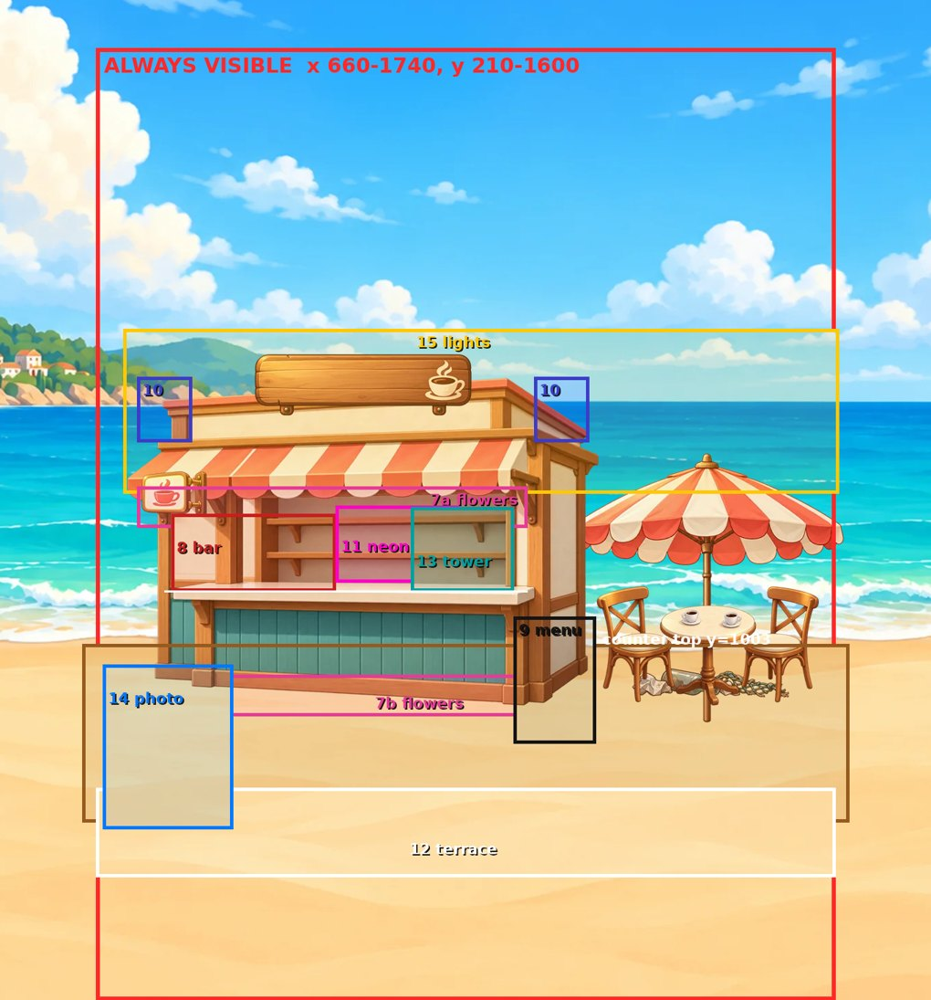

# Merge Café Lite · 美术资源需求 — 给 Codex

Issue #38 的主界面效果图（`art/issue-38-main-screen/`）定了风格方向。这份文档把它**拆成游戏要用的逐个资源**，写清楚每个资源的尺寸、内容、命名和接入方式。

- 风格依据：`策划案.md` §9、`style-references.md`、#38 竖屏效果图。三者冲突时以效果图为准。
- 现状：程序已经全部用占位图跑通（#40 / #41 / #42）。资源按下面的 id 交付后**同名替换**，玩法代码不用改。
- 占位图长什么样：`docs/selftest/m1/`、`m2/`、`m3/` 里的截图。可以对照占位的位置和大小来画。

## 交付状态

| 批次 | 状态 |
|---|---|
| P0（28 张） | ✅ 已交付（`codex/merge-cafe-p0-art` @ `fe96d78`）并接入。运行包里 PNG 已做无损压缩（像素不变）：2.25 MB → 1.75 MB |
| 第二批 A 批（12 张） | ✅ 已交付（`codex/merge-cafe-batch-a-art` @ `e206130`）并接入：头图 2、装修底图 + 破摊 3 + 第一幕 5 图层、漫画 1 |
| 第二批 B 批 | ⏳ 待画，**规格见 §5.4**（第二、三幕 10 图层 + 漫画 2）。到图前第二、三幕用程序占位 |
| 第二批 C 批 | ⏳ 待画（小图标、底栏、绿植、木纹、浓缩液返修） |

## 第二批待画清单（按优先级）

首个会话（约 10 分钟）只会玩到**第一幕 + 第 1 格漫画**，所以 A 批就是 20 人测试时玩家真正看得到的全部画面，请优先。

| 批 | 资源 | 数量 | 规格见 | 现在游戏里是什么 | 接入 |
|---|---|---|---|---|---|
| **A** | Merge 页头图（竖屏 + 横屏） | 2 | §8.1 | 从 #38 效果图裁的临时图 | 放图即替换 |
| **A** | 装修场景底图 `scene_base` + 破摊三件 `shabby_stall` / `shabby_table` / `shabby_litter` | 4 | §5.1–5.2 | 程序画的色块 | 到图后程序接入 |
| **A** | 第一幕 5 个装修图层：`tables` `parasol` `sign` `counter` `lightbox` | 5 | §5.3 | 程序画的色块 | 到图后程序接入 |
| **A** | 漫画 `comic_01` | 1 | §6 | SVG 剪影占位 | 到图后程序接入 |
| B | 第二幕 5 个图层：`deck` `flowers` `bar` `menu` `speakers` | 5 | §5.3 | 色块 | 到图后程序接入 |
| B | 第三幕 5 个图层：`neon` `terrace` `tower` `photo` `lights` | 5 | §5.3 | 色块 | 到图后程序接入 |
| B | 漫画 `comic_08`、`comic_15` | 2 | §6 | 剪影占位 | 到图后程序接入 |
| C | 小图标：`icon_lock` `icon_check` `icon_clock` `icon_hand` | 4 | §7 | 程序画的占位 | 放图即替换 |
| C | 底栏图标：`nav_cafe` `nav_merge` `nav_tasks` | 3 | §7、§8.2 | SVG 占位 | 放图即替换 |
| C | 棋盘两侧绿植：`deco_plant_pot` `deco_plant_fern` `deco_plant_bush` | 3 | §8.2 | 程序画的占位 | 放图即替换 |
| C | 木地板背景 `bg_wood_tile` | 1 | §8.3 | 纯色 + 线条 | 到图后程序接入 |
| C | 修改 `item_coffee_03`（浓缩液） | 1 | §8.4 | P0 交付版 | 放图即替换 |

**包体**：P0 + 临时头图现在占 1.85 MB，美术总额度 4 MB，第二批合计请控制在 **≤ 2.0 MB**（建议：头图 2 张 ≤ 0.3 MB，场景底图 + 18 个图层 ≤ 1.3 MB，漫画 3 张 ≤ 0.25 MB，其余 ≤ 0.15 MB）。场景、头图、漫画用 WebP（质量 85），图标用 PNG。

## 通用规则

1. **格式**：图标类交透明 PNG-32；场景和漫画可以交 WebP（质量 85）或 PNG。sRGB。
2. **命名**：文件名 = 下表里的 id，全小写，扩展名 `.png` / `.webp`。
3. **图里不放文字**。英文文案都在 `src/locale/en.json` 里，由程序排字。唯一的例外是 Logo（品牌字）。招牌、菜单板、订单卡上的字都由程序写，美术只画底板。
4. **不画落地阴影**。物品和生成器底下的椭圆影子由程序画。图标自身的体积明暗（3/4 视角、柔和投影、左上光源）照常画。
5. **留边**：主体占画布约 88%，居中，四周留透明边。程序会做弹跳放大，留边可以避免裁切。
6. **字体**：UI 用 Nunito（已随 #38 交付，程序已接入）。效果图里的排字只是示意，不需要单独出字图。
7. **包体预算**：全部美术压缩后 **≤ 4 MB**（总包体红线 5 MB，程序本身约 0.08 MB）。各类的大致额度见每节末尾。
8. **人物**：欧美成人比例（6–7 头身），五官自然。不要日系大眼，不要 Q 版大头。

## 接入方式

| 类别 | 放哪里 | 怎么生效 | 状态 |
|---|---|---|---|
| 物品图标、生成器 | `assets/items/<id>.png` | 把 id 加进 `src/config/art.json` 的 `items`，然后跑 `python3 tools/build.py` | **已接入**，放进去立刻替换 |
| 顾客头像 | `assets/avatars/<id>.png` | 把 id 加进 `art.json` 的 `avatars`，然后构建 | **已接入** |
| Merge 页头图 | `assets/scene/<id>.webp` | 把 id 加进 `art.json` 的 `scene`，然后构建 | **已接入**（现在放的是临时图，同名覆盖即可） |
| 场景底图、装修图层 | `assets/scene/<id>.webp` + `assets/scene/layers.json` 坐标 | 把 id 加进 `art.json` 的 `cafe`，然后构建 | **已接入**（A 批），B 批图层同样放图 + 补坐标 + 登记即可 |
| 漫画 | `assets/comics/<id>.webp` | — | 到图后由程序接入 |
| 货币图标、Logo、小图标、底栏图标 | `assets/ui/<id>.png` | 把 id 加进 `art.json` 的 `ui`，然后构建 | **已接入**（顶栏 / 底栏的 DOM 图标和画布里的图标都会替换） |

"已接入"这一栏已经实测过：放测试 PNG 进去并登记后，棋盘、订单卡、生成器按钮、顶栏、底栏、Logo 显示的都是新图。登记了不存在的文件或未知 id 时，构建会直接报错。

---

## 1. 物品图标（P0，16 张）

**规格**：256×256 透明 PNG。实际显示尺寸为：棋盘格里 45–75 CSS px（手机到平板），订单卡上最大约 100 CSS px，按 2 倍屏渲染。所以 256 是够的，也不要更大。

**最重要的要求：每一级"多一个可见元素"，并且在 48px 下一眼能区分。** 不许只换颜色来充等级（策划案 §9，参照 Travel Town）。同一条链的相邻两级，轮廓必须明显不同。

### 咖啡链（策划案 §4）

| id | 名称（游戏内英文） | 画什么 | 和上一级的区别 |
|---|---|---|---|
| item_coffee_01 | Coffee Beans 咖啡豆 | 3–4 颗浅棕色生咖啡豆，散放 | — |
| item_coffee_02 | Roasted Beans 烘焙豆 | 一把金属量勺，盛满深色油亮的烘焙豆 | 加量勺；豆子变深变亮 |
| item_coffee_03 | Espresso 浓缩液 | 白色小浓缩杯（无托盘），表面有金色油脂层 | 变成杯装液体 |
| item_coffee_04 | Americano 美式 | 较高的白色马克杯，黑咖啡，下面有托盘 | 杯子变高；加托盘 |
| item_coffee_05 | Latte 拿铁 | 透明玻璃杯，能看到奶和咖啡分层 | 玻璃杯 + 分层 |
| item_coffee_06 | Latte Art 拉花拿铁 | 宽口瓷杯，表面心形拉花，托盘 + 小勺 | 加拉花和小勺 |
| item_coffee_07 | Cold Brew 特调冷萃 | 高玻璃杯，冰块，吸管，杯壁有冷凝水珠 | 加冰块和吸管 |
| item_coffee_08 | Sea Salt Coffee 招牌海盐咖啡 | 高杯，顶部厚厚一层海盐奶盖，撒盐粒，青绿色吸管，杯边挂一枚小贝壳或柠檬片 | 加奶盖和装饰。这是"招牌"，要最华丽 |

### 烘焙链

| id | 名称（游戏内英文） | 画什么 | 和上一级的区别 |
|---|---|---|---|
| item_bake_01 | Flour 面粉 | 一小袋面粉，麻袋或纸袋，袋口露出白色面粉 | — |
| item_bake_02 | Dough 面团 | 圆面团，表面撒着面粉 | 变成面团 |
| item_bake_03 | Raw Loaf 面包胚 | 整形好的长条生面包胚，表面有割口，颜色浅 | 有形状和割口 |
| item_bake_04 | Toast 吐司 | 一片金黄吐司，边缘烤色深 | 烤熟、变成切片 |
| item_bake_05 | Sandwich 三明治 | 三角三明治，露出生菜、番茄、芝士 | 加馅料 |
| item_bake_06 | Fruit Tart 水果塔 | 圆形塔皮，上面堆满莓果 | 换成甜点；加水果 |
| item_bake_07 | Cream Cake 奶油蛋糕 | 小号整个奶油蛋糕，顶上一圈奶油花和草莓 | 加奶油裱花 |
| item_bake_08 | Party Cake 庆典大蛋糕 | 双层蛋糕，插蜡烛或小烟花棒，侧面有彩色装饰 | 双层 + 蜡烛。最华丽 |

**额度**：16 张合计约 0.5 MB。

## 2. 生成器（P0，2 张）

**规格**：256×256 透明 PNG，显示在棋盘下方的按钮左侧，约 60–70 CSS px。

| id | 名称 | 画什么 |
|---|---|---|
| gen_coffee_machine | Coffee 咖啡机 | 复古意式咖啡机，参考 #38 效果图里的红色款，出水口下放一只杯子 |
| gen_ingredient_box | Ingredients 食材箱 | 木箱，里面露出面粉袋、鸡蛋、一把麦穗，参考效果图 |

冷却状态由程序处理：叠一层暗色加上进度环和倒计时，**不需要单独出灰态图**。

**额度**：约 0.1 MB。

## 3. 顾客头像（P0，6 张）

**规格**：256×256 PNG，**图里自带底色和圆角**（圆角半径约为边长的 18%，底色用浅青或浅奶油）。程序不会再裁切。显示在订单卡左侧，最大约 110 CSS px。

构图是头 + 肩，正面或 3/4 侧，表情友好，和效果图里三位顾客同一画风。6 个人要在年龄、性别、肤色、发型上明显不同，订单卡并排时要能一眼区分。

| id | 建议形象（可调整） |
|---|---|
| avatar_customer_01 | 60 多岁女士，银发，草编遮阳帽（效果图第一位） |
| avatar_customer_02 | 30 多岁男士，深色卷发，胡子，眼镜（效果图第二位） |
| avatar_customer_03 | 20 多岁女士，棕色卷发，头顶墨镜，大耳环（效果图第三位） |
| avatar_customer_04 | 40 多岁男士，深肤色，短发，亚麻衬衫 |
| avatar_customer_05 | 20 多岁男士，金发，冲浪 T 恤 |
| avatar_customer_06 | 30 多岁女士，东亚面孔，齐肩黑发，条纹海魂衫 |

**额度**：约 0.3 MB。

## 4. 货币图标、Logo（P0）

| id | 规格 | 画什么 |
|---|---|---|
| icon_energy | 128×128 透明 PNG | 黄色闪电，和效果图顶栏一致 |
| icon_coin | 128×128 | 金币，正面带 $ 或贝壳纹 |
| icon_star | 128×128 | 金色五角星 |
| logo_merge_cafe_lite | 1024×384 透明 PNG | 木牌上写 "Merge Café"，右下角小字 "Lite"，配咖啡杯和叶子，参考效果图。**这是图中唯一允许放文字的资源** |

钻石图标**本期不要**（手游版再开）。

**额度**：约 0.2 MB。

---

## 5. 场景：破摊底图 + 15 个装修图层（P1）

这是装修 Meta 的核心。策划案 §6 要求**每个节点的前后变化都肉眼可见**，三幕的对比强度参照 Seaside Escape。

程序里已经用色块做好了完整的占位版，**位置关系可以直接照抄**。对比图见 `docs/selftest/m3/deco-progress-p.jpg`（竖屏）和 `deco-progress-l.jpg`（横屏），四格分别是装了 0 / 5 / 10 / 15 个节点。

### 5.1 画布与安全区

场景在不同屏幕上的比例差别很大：竖屏 Café 页约 0.7:1，横屏约 3:1，Merge 页顶部的场景条约 3:1。所以统一用**一张大画布，程序按"填满再居中裁切"显示**。

- **母画布 2400×1600**（1x，交付 1x 即可）。
- **必见区（2026-10-21 实测更新）：x 660–1740、y 210–1600**。12 种屏幕（手机竖屏 / 横屏、平板、桌面）实测的交集：左右被窄竖屏卡住，上下几乎全可见（顶上 210 以内会被顶栏盖住）。**小摊前面的沙地（y 1180–1600）在所有屏幕上都看得见，是 B 批最主要的空地。**
- 框外是延伸区：天空、海、远岛、沙滩 / 木地板往四周铺满，不能留空。
- 地平线大约在 y 860，地面（海和沙滩的交界）大约在 y 1100。

### 5.2 底图和"破摊"图层

| id | 类型 | 内容 |
|---|---|---|
| scene_base | 不透明，2400×1600 整张 | 天空、云、海、远处小岛和小镇、帆船、沙滩。**不含小摊**。阳光晴朗，青绿海水（主色 `#48B8AF`） |
| shabby_stall | 透明，裁切交付 | 破旧小摊：灰褐色旧木板墙带裂缝，塌陷的破木板顶，两个木箱当柜台。**a1_counter 解锁后程序会隐藏它** |
| shabby_table | 透明 | 一张塌了的旧桌子 + 一个歪倒的凳子。**a1_tables 解锁后隐藏** |
| shabby_litter | 透明 | 沙地上的垃圾：纸团、空瓶、破渔网。**a2_deck 解锁后隐藏** |

### 5.3 装修图层（id 与 `src/config/deco.json` 的 `layer` 字段对应）

每个图层是一张**裁切到内容大小的透明图**，另外交一份位置表 `assets/scene/layers.json`，格式为 `{"<id>": [x, y]}`，x、y 是这张图左上角在 2400×1600 母画布里的坐标。

| 幕 | 节点（游戏内英文） | 星 | 图层 id | 画什么 | 大致位置 |
|---|---|---|---|---|---|
| 1 破摊修复 | Tables & Chairs | 1 | tables | 一张圆桌 + 两把椅子，桌上两只咖啡杯 | 小摊右侧前景 |
| | Beach Parasol | 1 | parasol | 珊瑚色 / 奶油色条纹沙滩伞，立在桌子中间 | 桌子正上方 |
| | Café Sign | 1 | sign | 挂在小摊顶上的木招牌，**只画底板和咖啡杯图形，不写字** | 小摊顶部正中 |
| | New Counter | 1 | counter | **修好的整个小摊**：奶油色墙、珊瑚 / 奶油条纹雨棚、木质柜台（奶油色台面）。替换掉 shabby_stall | 小摊位置 |
| | Light Box | 2 | lightbox | 墙上一个发暖光的小灯箱，图案是咖啡杯，带柔光晕 | 小摊墙左上 |
| 2 海景升级 | Wooden Deck | 2 | deck | 铺满整个地面的木地板（横向木条），替换沙地 | 整条地面 |
| | Flower Wall | 2 | flowers | 小摊墙顶的一排花藤，加两侧地上的两盆花 | 墙顶 + 两侧 |
| | Coffee Bar | 3 | bar | 柜台上的红色意式咖啡机 + 玻璃面包罩 | 柜台左段 |
| | Menu Board | 3 | menu | 墙上的木框黑板菜单，**只画粉笔线条，不写字** | 墙右侧 |
| | Speakers | 3 | speakers | 墙顶两角各一只小音箱（程序会加跳动的音符） | 墙顶两角 |
| 3 网红打卡 | Neon Sign | 3 | neon | 墙上的粉色 + 青色霓虹灯，图形为咖啡杯或爱心，自带外发光 | 墙中央 |
| | Sun Terrace | 3 | terrace | 前景白色栏杆 + 一张小边桌（带一盆花） | 画面最前沿 + 右侧 |
| | Drink Tower | 3 | tower | 柜台上叠成金字塔的彩色饮品杯（3 层） | 柜台右段 |
| | Photo Wall | 3 | photo | 立式拍照框，青色边框，中间画爱心或翅膀，打卡用 | 画面最右侧 |
| | Fairy Lights | 3 | lights | 从小摊顶一路拉到画面右侧的彩色灯串，暖黄 / 粉 / 青三色灯泡 | 画面上部横跨 |

**叠放顺序**（从后往前）：

scene_base → deck → shabby_litter → parasol → photo → terrace → shabby_stall 或 counter → sign → lightbox → flowers → menu → speakers → neon → bar → tower → shabby_table 或 tables → lights

**对比强度要求**：
- 装了 0 个节点（破摊）：整体灰褐、冷清。
- 装完第一幕（5 个）：小摊明显"修好了能营业"。
- 装完第二幕（10 个）：温馨的海边咖啡馆。
- 装完第三幕（15 个）：色彩饱和、灯光璀璨的网红店。

占位版用像素对比实测，破摊到全装完的画面变化约 50%。正式图应当不低于这个程度。

**额度**：底图 + 18 个图层合计约 2 MB。底图用 WebP，图层用 PNG 或 WebP。

---

### 5.4 B 批：第二、三幕 10 个图层的精确位置（基于 A 批实际小摊，2026-10-21）

§5.3 的"大致位置"写于 A 批之前，**B 批以本节为准**。坐标都是 2400×1600 母画布像素，框是图层不透明内容的大致范围（可以小于框，不要超出必见区）。交付时照 A 批的做法，把每个图层左上角写进 `assets/scene/layers.json`。

**A 批小摊的实测几何（B 批对齐用）**：小摊整体 x 702–1398、y 689–1174；屋顶上沿约 y 720；条纹雨棚 y 790–870（下沿扇贝边约 y 860）；后墙 + 两层搁板 x 900–1260、y 880–990；**柜台台面 y = 1003**（台面上的东西底边落在这条线上）；柜台前板 y 1015–1165；底座 y ≈ 1170；右侧山墙 x 1300–1395；左立柱灯箱 x 727–823、y 816–898。桌椅 + 伞 x 1353–1753、y 802–1195。

| 节点 | 图层 id | 框（x0–x1, y0–y1） | 画什么 | 要点 |
|---|---|---|---|---|
| 6 | `deck` | 640–1760, 1080–1340 | 浅色木栈台：横向木板 + 前沿一圈侧板厚度，从小摊底下一直铺到桌椅下 | **画在最底层**，小摊和桌椅"站"在上面；上沿会被小摊挡住，可以只画到 y 1080；**必须完整盖住 `shabby_litter`（x 1430–1686, y 1090–1180）**，deck 解锁后垃圾层停画；前沿（y ≈ 1300–1340）要看得到木板厚度，这是第二幕开场最大的变化 |
| 7 | `flowers` | (a) 720–1290, 850–910 ＋ (b) 760–1280, 1125–1185 | (a) 沿雨棚扇贝下沿挂一串粉 / 珊瑚 / 白小花和绿叶藤；(b) 柜台前板底部一条长花槽 | 一张图，中间留透明；花色跟头图一致；(a) 不要挡住搁板里的东西太多 |
| 8 | `bar` | 770–1010, 890–1003 | 柜台左段：红色复古意式咖啡机（和 `gen_coffee_machine` 同款造型）＋ 磨豆机 ＋ 两三只杯子 | **底边落在 y 1003 台面**；第 8 格漫画画的就是它 |
| 9 | `menu` | 1270–1390, 1040–1225 | 立在栈台上的 A 字型木框黑板菜单，**只画粉笔线条和小图案，不写字** | 压在小摊右下角前面、桌椅左边；底边落在栈台上（≈ y 1220） |
| 10 | `speakers` | 720–800 ＋ 1300–1380, 690–785 | 屋顶两角各一只小木箱音箱 | 一张图两只，中间透明；底边落在屋顶上沿（≈ y 725–785）；音符由程序加 |
| 11 | `neon` | 1010–1190, 878–990 | 挂在后墙上的霓虹灯：粉色咖啡杯轮廓 ＋ 青色爱心 / 波浪线，自带一圈柔光 | 压在搁板前面；外发光画进透明边里（半透明可以）；**不写字** |
| 12 | `terrace` | 660–1740, 1290–1420 | 栈台前沿的一排白色木栏杆，两端各一根带小灯笼的立柱，中间（x ≈ 1120–1300）留一个入口缺口 | **画在最前景**（压在桌椅和拍照框前面），高度控制在 ~100 px，不要挡住柜台 |
| 13 | `tower` | 1120–1270, 880–1003 | 柜台右段：三层饮品塔，粉 / 奶油 / 薄荷色的冰饮杯叠成小金字塔，顶上一杯带奶油和吸管 | 底边落在 y 1003 台面 |
| 14 | `photo` | 670–860, 1110–1350 | 立在栈台左前角的拍照框：青色木框 ＋ 中间爱心 / 翅膀图案 ＋ 底座，旁边可以挂两个小气球 | 前景道具，会挡住小摊左下角一点，可以；底边落在栈台前沿 |
| 15 | `lights` | 700–1745, 620–860 | 两串彩色灯串：一串从小摊左屋檐拉到招牌，一串从右屋檐拉到伞顶再到画面右缘；暖黄 / 粉 / 青三色灯泡，每颗带一点光晕 | **画在最上层**；自然下垂（悬链线）；灯泡之间留空，不要糊成一条；闪烁由程序做 |

**叠放顺序**（从后到前，程序按此画，已更新到 `main.js` 的 `ART_ORDER`）：
`scene_base → deck → shabby_litter(未铺栈台时) → parasol → shabby_stall / counter → sign → lightbox → flowers → speakers → neon → bar → tower → menu → shabby_table / tables → photo → terrace → lights`

**对比强度目标**：A 批接入后实测像素变化——第 1 节点 8.9%、第一幕装完 16.4%；**第二幕装完（10 节点）目标 ≥ 30%、全部装完（15 节点）≥ 50%**（相对破摊；现在用程序占位是 39%）。第二幕的大头是 `deck` 和 `flowers`，第三幕的大头是 `terrace` 和 `lights`。

**B 批体积**：场景图层剩余额度 972 KB（10 张，平均 ≤ 90 KB；大部分透明图应远小于这个），漫画剩余 140 KB（2 张，**每张 ≤ 70 KB**，`comic_01` 用了 110 KB，B 批请用 WebP 质量 75–80 或适当简化背景）。

## 6. 漫画（P2，3 格）

**规格**：1200×600（2:1），WebP 或 PNG，**图里不放台词**（台词由程序显示在图下方）。解锁第 1 / 8 / 15 个装修节点时弹出，单格，不分镜。

主角是效果图里的咖啡师：成年女性，棕色卷发盘起，红色发带，绿色围裙。人物比例和表情参照 Lily's Garden（成熟、温暖、不幼稚）。

| id | 节点 | 台词（en.json） | 画面 |
|---|---|---|---|
| comic_01 | 第 1 节点 Tables & Chairs | "A real table! Customers can finally sit down." | 白天。主角刚摆好新桌椅，第一位客人（avatar_customer_01 的那位女士）笑着坐下 |
| comic_08 | 第 8 节点 Coffee Bar | "The new bar is gorgeous. People are lining up!" | 傍晚暖光。新吧台前排起小队，主角在咖啡机后忙碌 |
| comic_15 | 第 15 节点 Fairy Lights | "Look at those lights… we did it. Best café on the coast!" | 夜晚。灯串亮起，主角和一位朋友举杯庆祝，背景是装修完成的整个咖啡馆 |

**额度**：约 0.3 MB。

**B 批漫画补充（参照已交付的 `comic_01` 画风和人物）**：`comic_08` 画面里要出现 `bar` 那台红色咖啡机和第二幕的木栈台 / 花藤；`comic_15` 是夜景，`lights` 灯串和 `neon` 霓虹全部亮起，`terrace` 栏杆和拍照框入画，咖啡师和一位朋友（可用头图里的蓝衬衫顾客）举杯。两张都**不写台词**。

## 7. 小图标（P2）

这些占位已经能用，有时间再做。规格都是透明 PNG。

| id | 规格 | 用途 |
|---|---|---|
| icon_lock | 96×96 | 未解锁格子上的锁 |
| icon_check | 96×96 | 订单已交 / 棋盘物品可交单时的绿色勾 |
| icon_clock | 96×96 | 订单倒计时 |
| icon_hand | 128×128 | 新手引导的手指（白手套风格，指尖在图的左上 1/4 处） |
| nav_cafe | 96×96 | 底栏 Café 按钮（小摊图形） |
| nav_merge | 96×96 | 底栏 Merge 按钮（交叉的勺叉或合并箭头） |

## 8. 首测后新增

### 8.1 Merge 页头图（A 批，2 张）

头图从**屏幕最顶上**铺起，顶栏（体力 / 金币 / 星星三个胶囊）浮在图上，和 #38 竖屏效果图的上半部分一样。程序按"填满再裁切"显示：宽度铺满，**竖向放不下时从底部裁**。

| id | 交付尺寸 | 实际显示区（参考） | 构图分区（按图高的比例） |
|---|---|---|---|
| `header_merge_p`（竖屏） | **1500×1060** WebP，不透明 | 390×844 手机上是 390×275；430×932 上是 430×322；矮屏 375×667 只有 375×121 | **0–20%**：会被顶栏盖住，只放背景（雨棚、天空、藤蔓），不放人脸和 Logo。**20–48%**：Logo 木牌居中。**35–75%**：咖啡师（左，柜台后）和一位顾客（右，柜台前）的脸和上半身。**75–100%**：柜台、手、杯子，矮屏会被裁掉 |
| `header_merge_l`（横屏左栏） | **1000×1600** WebP，不透明 | 1280×720 上是 335×644；1920×1080 上约 625×1004；844×390 上是 258×314 | 主体是咖啡师（半身，水平 30–55% 位置），Logo 放左上（横向 5–60%，纵向 3–16%）。底部 80 px（1x）会被底栏盖住。窄屏会从两侧裁，焦点在横向 42% |

内容参照 #38 效果图（咖啡师：棕色卷发盘起、红色发带、绿色围裙；顾客：深色卷发、蓝衬衫），背景是海、小岛、帆船、遮阳伞。Logo 直接画在图里（品牌字，例外允许）。

> 注意头图展示的是"完整的咖啡馆"，Café 页的装修场景（§5）展示的是"从破摊开始装修的进度"，两者不需要一致。

### 8.2 底栏图标、棋盘两侧绿植（C 批）

| id | 规格 | 用途 |
|---|---|---|
| `nav_tasks` | 96×96 透明 PNG | 底栏 Tasks 按钮（剪贴板 + 勾），和 `nav_cafe`、`nav_merge` 同一画风 |
| `deco_plant_pot` | 256×256 透明 PNG | 棋盘右侧的大花盆：赤陶盆 + 绿叶 + 粉色 / 珊瑚色小花，参照效果图右下角那盆 |
| `deco_plant_fern` | 256×256 透明 PNG | 棋盘左下的蕨叶丛（无盆，叶子从下往上散开） |
| `deco_plant_bush` | 256×256 透明 PNG | 小开花灌木（白 / 粉花），放在底栏两侧 |

绿植会被棋盘木框挡住一部分，像是"从棋盘后面探出来"。主体靠下，底边贴地。

### 8.3 木地板背景（C 批）

| id | 规格 | 用途 |
|---|---|---|
| `bg_wood_tile` | 512×512 **四方连续**（上下左右无缝）PNG 或 WebP | Merge 页棋盘后面的木板墙 / 地板，参照效果图订单栏与棋盘之间的浅色横向木板，颜色约 `#E6C48F`，纹理要淡，不能抢棋盘 |

### 8.4 修改：浓缩液 `item_coffee_03`

P0 验收时发现浓缩液（03）和美式（04）在 48 px 下最像：都是白杯黑咖啡，只靠托盘区分。请按 §1 原规格改：**小一圈的浓缩杯、没有托盘、表面一层明显的金色油脂（crema）**，和 04 的大马克杯 + 托盘拉开距离。只交这一张，同名覆盖。

## 不需要做的

- **UI 面板、按钮、订单卡底板、弹窗**：由程序用 CSS / WebGL 画（圆角、粗描边、木色、珊瑚按钮），这样省包体，也方便改。Codex 如果对颜色、圆角、描边粗细有意见，直接在 #38 里给出数值，程序照改。如果坚持要木纹质感，可以交九宫格 PNG 并注明切分边距。
- Tasks 按钮（不在 #39 范围）、钻石图标、多语言版本、角色动画序列帧。

## 自检清单（交付前过一遍）

- [ ] 文件名和本文 id 完全一致，全小写
- [ ] 图标 256×256 透明，主体居中、四周留边，没有落地阴影
- [ ] 把物品图标缩到 48px 并排看：同一条链的 8 级两两都能分清
- [ ] 图里没有英文文案（Logo 除外）
- [ ] 场景关键内容都在必见区 x 660–1740、y 210–1600 之内（B 批按 §5.4 的框放）
- [ ] 每个装修图层附带 layers.json 坐标；替换类图层（counter / tables / deck）能完全盖住对应的破摊内容
- [ ] 全部资源合计 ≤ 4 MB
