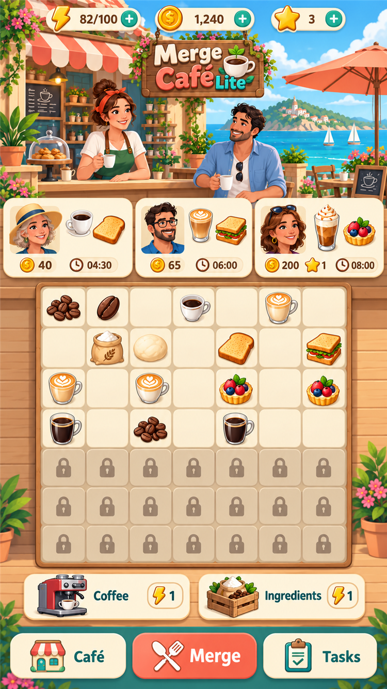
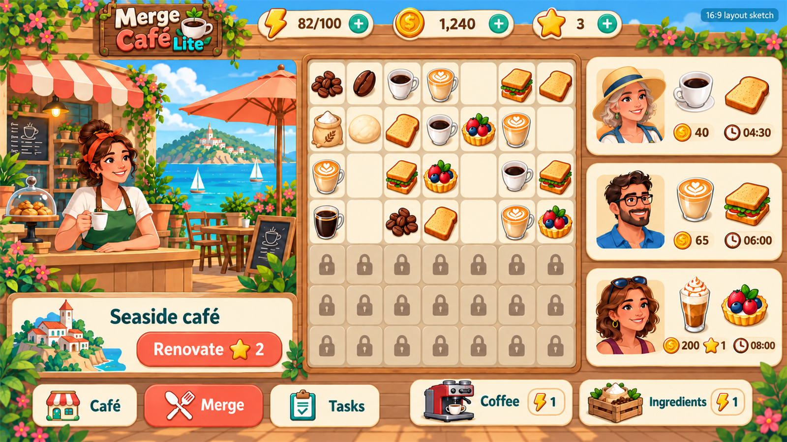

# Merge Café Lite — 主界面美术方向 v1

对应 Issue #38，依据同目录上级的《策划案 v0.2》和 `style-references.md`。本次只交第一阶段效果图，供 lijie 定方向、Muse QA；不是已确认终稿，不关闭 Issue #38。未修改游戏代码。

## 交付文件

- `main-screen-portrait-750x1334.png`：竖屏整屏效果图，750 × 1334。
- `main-screen-landscape-sketch-1600x900.png`：桌面横屏 16:9 布局草图，1600 × 900；用于验证重排布局，精细程度不等同竖屏效果图。
- `generation-prompts.md`：内置 image_gen 生成与修改提示词记录。
- `fonts/Nunito-Variable.ttf` 与 `fonts/OFL.txt`：英文 UI 字体及完整授权。

## 风格应用

仅吸收构图、配色和图形语言，不导入参考游戏截图、角色或素材。

| 参考 | 本次应用 |
| --- | --- |
| Gossip Harbor | 青绿海水、奶油建筑、珊瑚点缀；场景、订单、棋盘信息层级 |
| Seaside Escape | 海边小摊与可辨认装修构件；本阶段只展示单一场景，不替代后续三幕对比 |
| Merge Mansion | 木材与沙色中性色、克制的道具阴影，平衡高饱和色 |
| Travel Town | 咖啡与烘焙物品的不同轮廓、配料和柔和投影；不是最终全套图标 |
| Lily's Garden | 成年人物自然五官、友好表情、暖调花草；避免日系大眼和 Q 版 |

主色：海水青绿 `#48B8AF`、奶油白 `#FFF4DB`、珊瑚橙 `#EF7965`；辅色为木棕和沙色。Logo 英文拼写固定为 **Merge Café Lite**。

## 字体与授权

指定英文落地字体：**Nunito**，界面文字建议 700、数字与按钮 800、Logo 字重 900。Nunito 使用 **SIL Open Font License 1.1**，允许用于商业游戏以及嵌入、随软件分发；分发字体时保留版权和授权，不单独售卖字体。

- [字体上游](https://github.com/google/fonts/tree/main/ofl/nunito)
- [授权原文](https://raw.githubusercontent.com/google/fonts/main/ofl/nunito/OFL.txt)
- Copyright 2014 The Nunito Project Authors (https://github.com/googlefonts/nunito)

效果图中的文字是 AI 栅格化近似排字，不能当作精确 Nunito 字形源文件；实现时应使用随附字体重新排字。字体文件仅作为美术交付附件，本 PR 不接入代码。

## 阶段边界

交付自检（人工目视 + PNG 元数据）：竖屏 750×1334；横屏 1600×900（16:9）。两图均为 7 列 × 7 行、上四行 28 格解锁、下三行 21 格锁定；均有三张订单卡、两个棋盘外生成器、体力/金币/星星顶栏、底部按钮。订单和生成器均未遮挡棋盘。Logo 拼写已目视核对。此自检不替代 Muse QA 或 lijie 的风格确认。

本次待确认：整体风格、竖屏信息层级、横屏布局。效果图确认后再交 16 个独立物品图标、生成器及灰态、货币图标、装修三幕与 15 节点、UI 组件/弹窗和漫画草图。效果图中的食物、角色和组件只是方向示例，不是可直接切图投入生产的完整资源包。

## 竖屏交接坐标（像素，供排版参考）

| 区域 | 大致边界 |
| --- | --- |
| 顶栏 | y 0–64 |
| 海边咖啡场景与 Logo | y 64–383 |
| 三张订单卡 | y 383–539 |
| 7×7 棋盘外框 | x 68–684，y 547–1101 |
| 两个生成器 | y 1108–1204 |
| 底部按钮 | y 1215–1320 |

坐标是对效果图的近似量取；实现时棋盘内 49 格应统一为正方格，维持 7×7 和完整可见优先。示意图单格略宽于高，具体自适应尺寸交由布局阶段等比校正。
