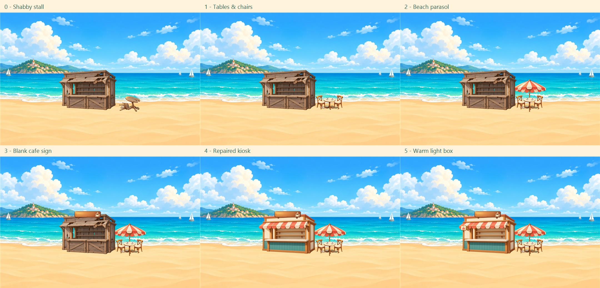
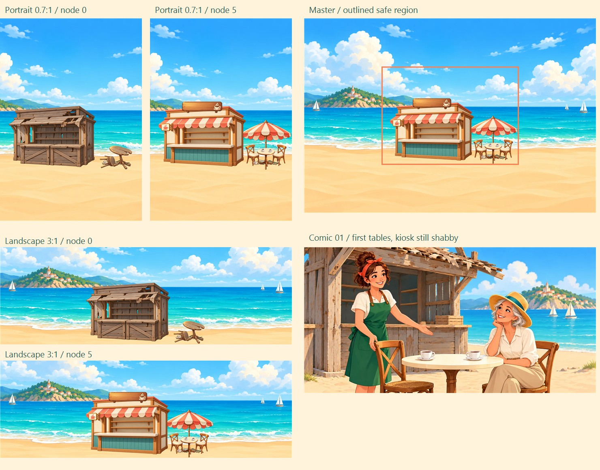
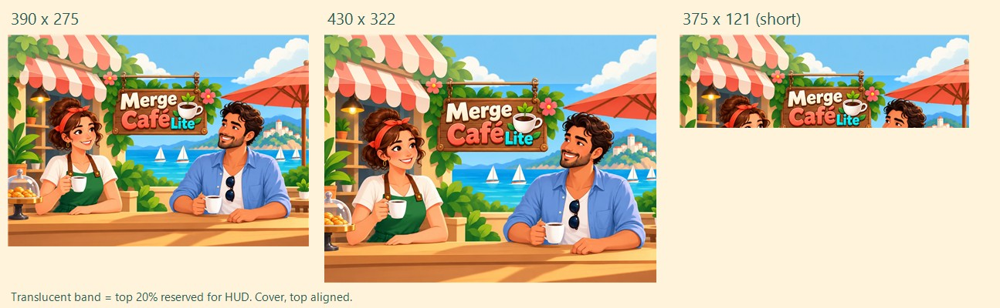
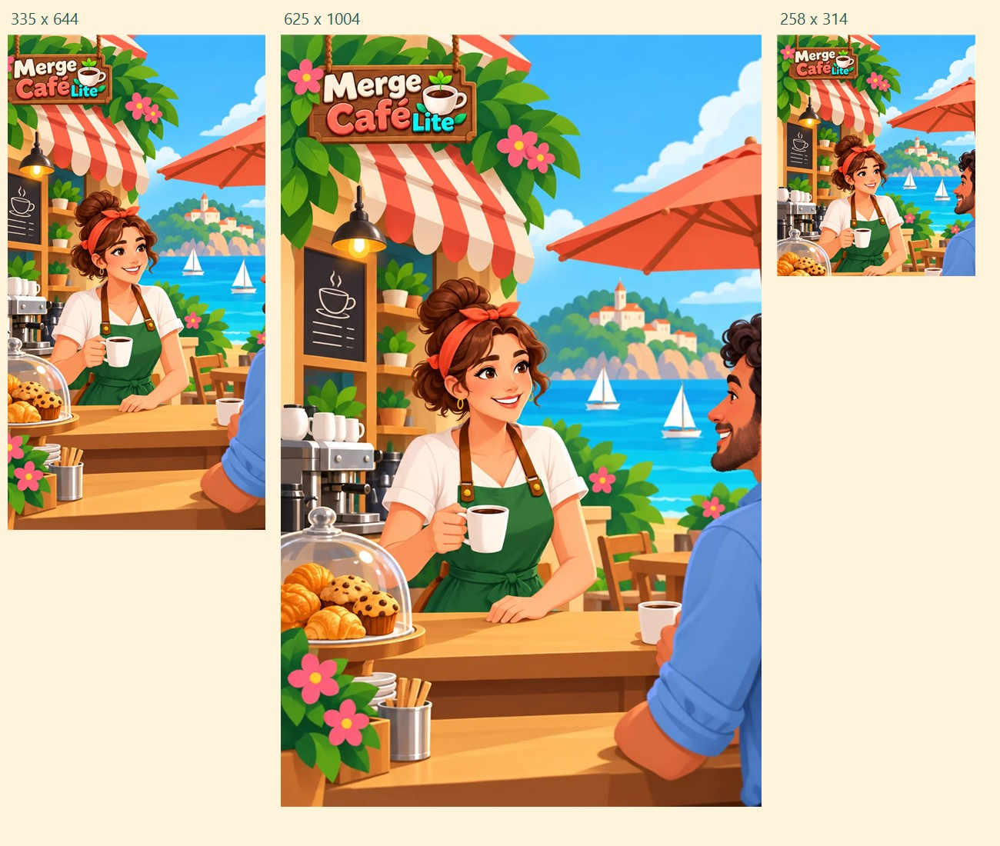

# Merge Café Lite — Issue #49 A 批交付

依据 `main` 的 ASSETS.md（blob `1e0694914f2147ff1425933ff7b56adf58214064`），基于提交 `5e4a5c9`。本批12张WebP，只交美术、图层坐标和交付说明；未修改代码、`art.json`、本地化或构建产物。登记和读图接入由 Claude 完成。本批不创建 PR。

## 交付文件

以下路径相对 `games/merge-cafe-lite/`。全部使用 WebP质量85，sRGB；8件透明图层保留alpha，2张头图、底图和漫画不透明。

| 文件 | 尺寸 | 字节 |
| --- | --- | ---: |
| `assets/scene/header_merge_p.webp` | 1500×1060 | 154606 |
| `assets/scene/header_merge_l.webp` | 1000×1600 | 141946 |
| `assets/scene/scene_base.webp` | 2400×1600 | 141754 |
| `assets/scene/shabby_stall.webp` | 700×495 | 74500 |
| `assets/scene/shabby_table.webp` | 301×200 | 15094 |
| `assets/scene/shabby_litter.webp` | 256×90 | 7188 |
| `assets/scene/tables.webp` | 340×230 | 21226 |
| `assets/scene/parasol.webp` | 410×399 | 16196 |
| `assets/scene/sign.webp` | 322×110 | 7018 |
| `assets/scene/counter.webp` | 700×493 | 40574 |
| `assets/scene/lightbox.webp` | 117×95 | 3962 |
| `assets/comics/comic_01.webp` | 1200×600 | 110352 |

`assets/scene/layers.json` 是8件透明图层左上角在2400×1600母画布上的坐标，不是接入配置。本批只按需求新增该坐标表。请使用图片原始尺寸绘制，再将整张母画布居中cover裁切，不要逐个图层单独cover或再次裁透明边。

## 图层与节点

本批从后到前：`scene_base → shabby_litter → parasol（已解锁时）→ shabby_stall 或 counter → sign（已解锁时）→ lightbox（已解锁时）→ shabby_table 或 tables`。

- 初始：底图＋破摊＋塌桌＋垃圾。
- 节点1：隐藏 `shabby_table`，显示 `tables`。
- 节点2：显示 `parasol`，伞柱与桌面中心对齐。
- 节点3：显示 `sign`。木牌左侧留白给程序排本地化文字，图内只画咖啡杯图案。
- 节点4：隐藏 `shabby_stall`，显示 `counter`；这是整个修复后小摊，不只是柜台。
- 节点5：显示 `lightbox`。
- 垃圾保留到B批节点6 `deck` 解锁时隐藏。替换时必须停画旧层，不能仅靠新层透明像素盖住旧图。

8个图层的矩形范围均完整落在必见区 x640–1760、y400–1200 内。母画布不含已烘焙的小摊或家具，海岛/海/沙滩铺满边缘。

以上为纯美术离线合成，来自最终WebP解码，不是游戏已接入截图。没有给图层画落地椭圆阴影。后续完整15节点的变化强度仍需在B批齐备后核对，本批没有声称达到全15节点50%的像素变化指标。

## 头图交接

直接同名替换两个临时头图。与装修页不同，头图展示已经营业的完整咖啡馆；头图里允许品牌字。两个角色沿用棕卷发盘髻/红发带/绿围裙咖啡师和蓝衬衫深卷发顾客。

- 竖屏：顶部20%留天空、雨棚与绿叶；Logo木牌约在25–47%高度，脸与半身分列两侧；底部可裁柜台、手和杯子。若开发侧更新 `sceneMeta.safeTop`，建议按木牌实测顶部取 **0.25**。本批未改该配置。
- 横屏左栏：图片本身为竖幅1000×1600；Logo约在横向7–41%、纵向4–14%；咖啡师焦点约在横向42%。保持现有横向焦点0.42、顶部对齐，底部80px用于被底栏遮挡。`safeTop`参考0.04。
- 检查了竖屏390×275、430×322、375×121，以及左栏335×644、625×1004、258×314的cover/top裁切。评审图淡色遮罩标出头图顶部20%区域，未模拟游戏实际顶栏胶囊或运行时safeTop补偿。
- **极矮屏限制**：375×121按指定顶部裁切只保留完整品牌字与人物上部，脸部会被截断。当前规格的121px窗口无法保留完整半身构图；如果产品要求该尺寸也完整露脸，需要另定矮屏专用构图或改变显示区高度。此项保留给产品/开发确认，未擅改代码。

## 漫画

第1节点：新桌椅已经摆好，银发草帽女士坐下；咖啡师站在旁边欢迎。背景仍是破木摊，不提前展示第一幕后或第二幕装修。图内没有台词，继续用本地化表的 `comic_01` 对应文案。

## 体积与自检

- A批12张合计 **734416字节（0.734MB）**。
- 头图合计296552字节，低于300000字节；底图＋本批8图层合计327512字节；漫画110352字节。
- 按第二批总额2000000字节计算，B/C还余 **1265584字节**。分类余量：场景972488字节，漫画139648字节，其余150000字节；头图余3448字节。
- 当前检出版本的全部运行用图片（P0＋A，共40张）合计 **2573618字节**，低于4000000字节。此统计没有包含JSON、字体和其他程序文件。
- `manifest.json`：逐图尺寸、字节、alpha、sRGB、边界、安全区和SHA-256。已检查12/12尺寸与不透明/透明要求、8/8图层安全区和透明外边缘。
- `generation-prompts.md`：内置image_gen逐图提示词与选稿记录。
- 本目录的4张JPG、清单、说明和提示词只用于评审，**不要打进运行资源包**。
- B/C未交：后两幕10图层、后两格漫画、小图标/底栏/绿植/木纹，以及浓缩液返修。本批没有改P0资源。
