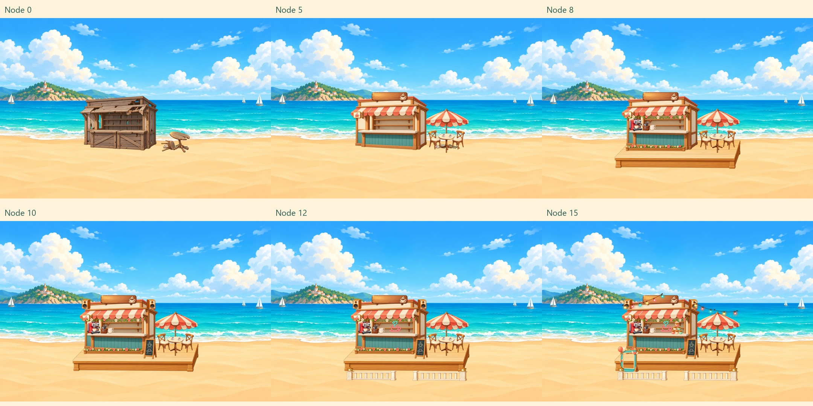
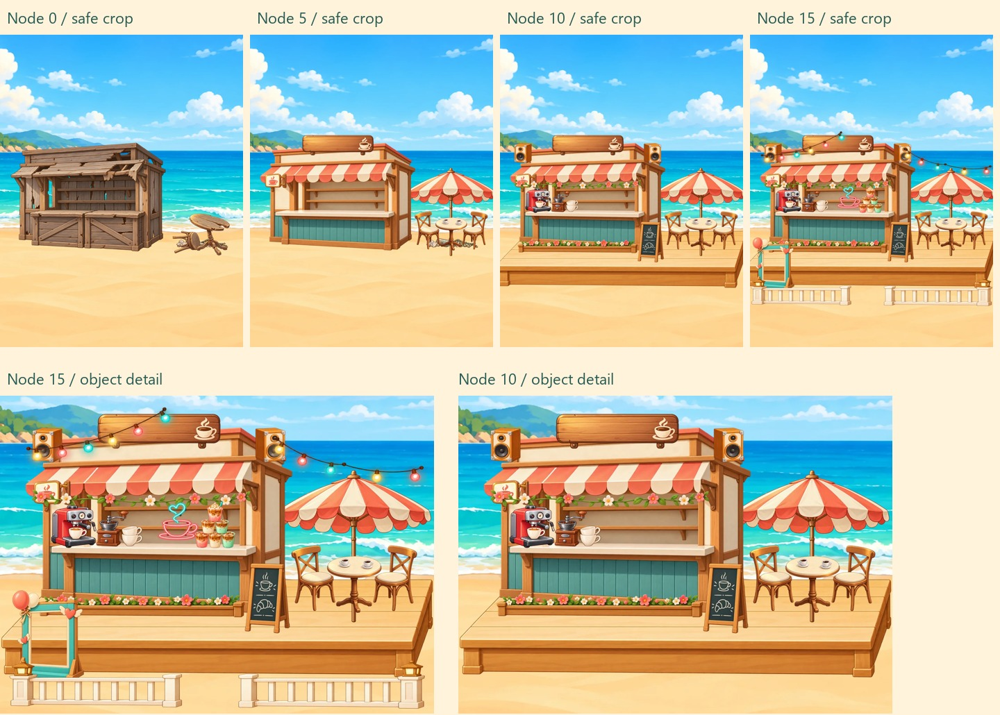
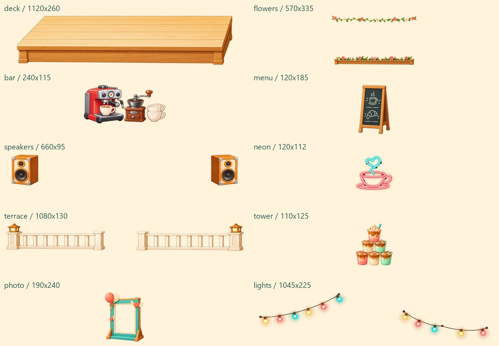
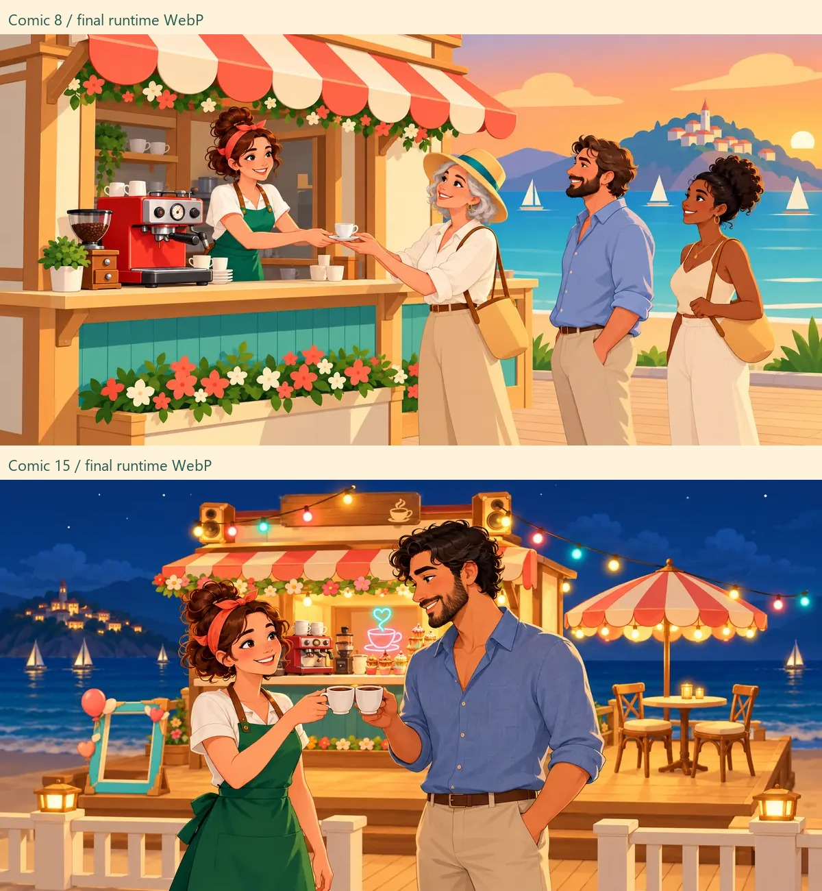

# Merge Café Lite — Issue #49 B 批美术交付

依据 main 提交 `686007d` 的 `ASSETS.md §5.4`、Issue #49 补充和同目录 `b-layout-guide.jpg`。分支：`codex/merge-cafe-batch-b-art`。

本批交付 10 个装修透明图层、2 张漫画和坐标表。只改美术文件、`assets/scene/layers.json` 和本文档；没有修改游戏代码、`art.json`、本地化或构建产物。登记、构建、运行时验收由 Claude 完成。本批不创建 PR、不代发 Issue 评论。

## 给 Claude 的接入说明

1. 取本分支的美术提交；保留 main 已有的接入代码。
2. 在 `art.json` 的 `cafe` 中登记以下 10 个 id，在 `comics` 中增加 `comic_08`、`comic_15`。本批未替开发侧改登记配置。
3. `layers.json` 只新增 B 批 10 个坐标，原 A 批 8 个坐标原样保留。按原图像素尺寸画在 2400×1600 母画布上，再整体居中 cover。不要对单层再次裁边或单独 cover，否则双音箱、花藤双带和灯串的内部间距会失效。
4. 沿用 main 已有 `ART_ORDER`。第 6 节点解锁后停止绘制 `shabby_litter`；旧桌、旧摊的替换关系照旧。
5. 漫画仍用现有本地化台词，图片内没有文字。第 8 节点展示新吧台、花藤与排队客人；第 15 节点展示灯串、霓虹、栏杆、拍照框和举杯庆祝。
6. 评审 JPG、布局参考、manifest、提示词与像素统计均在 `art/` 下，不应打入运行包。

叠放顺序：
`scene_base → deck → shabby_litter（未铺栈台）→ parasol → shabby_stall / counter → sign → lightbox → flowers → speakers → neon → bar → tower → menu → shabby_table / tables → photo → terrace → lights`

## 文件与坐标

以下路径相对 `games/merge-cafe-lite/`。坐标为整张交付图片左上角，包含 2px 透明边。WebP 场景质量 85；漫画按 B 批补充使用质量 75。全部像素按 sRGB 制作。

| 节点 | 文件 | 尺寸 | 左上角 x,y | 字节 |
| --- | --- | --- | --- | ---: |
| 6 | `assets/scene/deck.webp` | 1120×260 | 640,1080 | 28162 |
| 7 | `assets/scene/flowers.webp` | 570×335 | 720,850 | 34760 |
| 8 | `assets/scene/bar.webp` | 240×115 | 770,890 | 13992 |
| 9 | `assets/scene/menu.webp` | 120×185 | 1270,1040 | 9172 |
| 10 | `assets/scene/speakers.webp` | 660×95 | 720,690 | 7870 |
| 11 | `assets/scene/neon.webp` | 120×112 | 1040,878 | 9736 |
| 12 | `assets/scene/terrace.webp` | 1080×130 | 660,1290 | 32680 |
| 13 | `assets/scene/tower.webp` | 110×125 | 1140,880 | 8520 |
| 14 | `assets/scene/photo.webp` | 190×240 | 670,1110 | 13648 |
| 15 | `assets/scene/lights.webp` | 1045×225 | 700,635 | 37422 |
| 8 | `assets/comics/comic_08.webp` | 1200×600 | — | 65772 |
| 15 | `assets/comics/comic_15.webp` | 1200×600 | — | 69722 |

`neon`、`tower` 在需求框内收窄，以保留咖啡杯和饮品塔的自然比例；`lights` 在需求框内略收高，对齐屋檐与招牌。其余图层沿用指定框尺寸。图层内部由工具绘制，导出阶段仅测透明边、裁切、缩放和编码。

`comic_15` 为节省 614 字节省去冗余 ICC 元数据，像素颜色仍为 sRGB（标准浏览器按默认 sRGB 解码）；其他文件内嵌 sRGB ICC。没有通过降低分辨率压漫画。

## 已核对的美术条件

- 10 张图层均有真实 alpha，四边透明；双音箱、两段花带、栏杆入口、灯串空隙和拍照框中心保留透明。
- `bar` 与 `tower` 的可见底边均在母画布 y=1003；图片底部的 2px 透明边不计入台面接触线。
- 栈台覆盖原垃圾框 x1430–1686、y1090–1180 的全部位置；该框内 alpha ≥250 的覆盖率为 100%。运行时仍必须按规则停画旧垃圾层。
- 花藤不重画雨棚，花槽位于柜台前板下方；霓虹图案和菜单板都没有文字。
- 图片没有额外落地椭圆阴影。霓虹、灯串保留柔和外发光；闪烁和跳动音符交由程序。
- 漫画对照 A 批 `comic_01` 沿用咖啡师形象；第 8 格未提前加入第三幕装修。
- 已检查最终 WebP 解码后的第 0、5、6–15 节点离线叠放，以及 x660–1740、y210–1600 必见区裁切。这些是美术合成评审，**不是已经接入游戏的截图**。

## 对比强度：50% 尚未验收通过

原规格没有提供 8.9% / 16.4% 的截图和计算脚本，本文不将不同取样范围的结果混用。采用以下可复核口径：最终 WebP 按原尺寸离线叠放，和第 0 节点逐像素比较，RGB 三通道绝对差的最大值 >20 计为变化像素；不含 UI、动画、粒子和程序排字。

| 取样范围 | 第 5 节点 | 第 10 节点 | 第 15 节点 |
| --- | ---: | ---: | ---: |
| 整张母画布 2400×1600 | 9.62% | 13.56% | 15.19% |
| 必见区 x660–1740、y210–1600 | 24.59% | 34.46% | 38.63% |
| 装修所在矩形 x640–1760、y620–1420 | 41.24% | 58.10% | 65.09% |

**按必见区口径，第 10 节点达到 30%，第 15 节点未达到 50%。不能用装修局部的 65.09% 声称整屏达标。** 请开发侧用原始测量脚本、相同屏幕和静止帧复测；如原指标也是必见区绝对像素比例，后续还需专门提高第三幕变化范围。当前未擅自扩大 §5.4 指定框，也未改底图或程序来增加变化率。透明细栏杆与分离灯泡在视觉上明显，但覆盖面积较小。

`pixel-comparison.json` 同时保存阈值 0、10、20、30 的完整结果；阈值为 0 时，必见区第 15 节点为 43.53%，同样没有报成 50%。

## 包体

- 10 张场景：**195962 字节**，低于 972000。
- 漫画：**65772 + 69722 = 135494 字节**，每张均低于 70000。
- 包含 A 批 `comic_01`，三张漫画总计 **245846 字节**，低于 250000。
- B 批新增运行图片合计 **331456 字节（0.331 MB）**。
- 当前 `assets/` 中全部 52 张 PNG/WebP 合计 **2905074 字节（2.905 MB）**，低于 4 MB。该数值是仓库图片文件之和，不是开发侧构建后的完整包体。
- 文件尺寸、alpha、编码质量、字节数与 SHA-256 见 `manifest.json`。

## 评审图

生成使用内置 image_gen，提示词完整记录在 `generation-prompts.md`。不包含 C 批资源。
