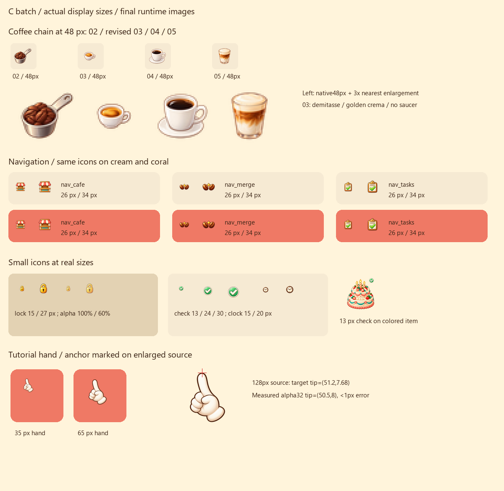
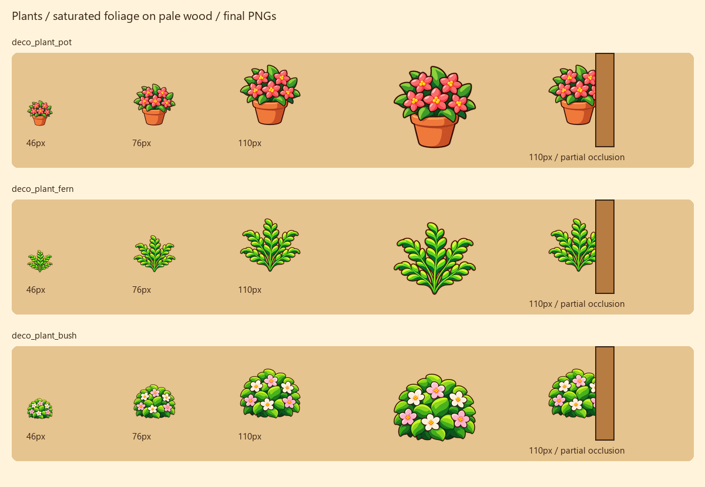
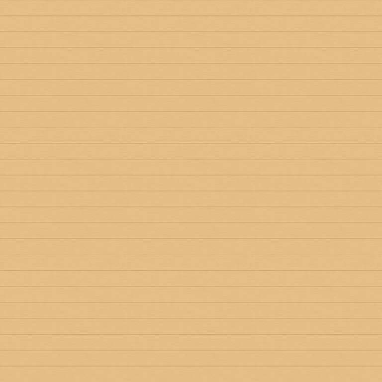

# Merge Café Lite — Issue #49 C 批美术交付

依据 main `e330644`（PR #55）的 `ASSETS.md §7`。分支：`codex/merge-cafe-batch-c-art`。

**12 张全部交付，无待画项。只提交图片和说明，未修改代码、`art.json`、坐标表或构建产物；不创建 PR、不代发 Issue 评论。**

## 给 Claude 的接入说明

取本分支美术提交，保留 main 的接入实现：

- `art.json.ui` 登记以下 10 个 UI id：`icon_lock`、`icon_check`、`icon_clock`、`icon_hand`、`nav_cafe`、`nav_merge`、`nav_tasks`、`deco_plant_pot`、`deco_plant_fern`、`deco_plant_bush`。
- `art.json.scene` 登记 `bg_wood_tile`，沿用现有 256 CSS px 平铺逻辑。
- `item_coffee_03.png` 同名覆盖，物品 id 已存在，无需另加 id。
- 然后由开发侧构建并做实际游戏回归。本文评审图是最终图片的离线缩放与合成，**不是已登记接入的游戏截图**。
- `art/issue-49-batch-c/` 里的说明、评审图、提示词和 manifest 不打入运行包。

## 文件与大小

路径相对 `games/merge-cafe-lite/`。11 张透明 PNG 均为 **32 位 RGBA、sRGB**；木板是不透明 sRGB WebP，质量 80。

| 文件 | 尺寸 | 字节 |
| --- | --- | ---: |
| `assets/items/item_coffee_03.png` | 256×256 | 26198 |
| `assets/ui/deco_plant_pot.png` | 256×256 | 41166 |
| `assets/ui/deco_plant_fern.png` | 256×256 | 47633 |
| `assets/ui/deco_plant_bush.png` | 256×256 | 46793 |
| `assets/ui/nav_cafe.png` | 96×96 | 11510 |
| `assets/ui/nav_merge.png` | 96×96 | 9899 |
| `assets/ui/nav_tasks.png` | 96×96 | 10934 |
| `assets/ui/icon_lock.png` | 96×96 | 9214 |
| `assets/ui/icon_check.png` | 96×96 | 14652 |
| `assets/ui/icon_clock.png` | 96×96 | 12975 |
| `assets/ui/icon_hand.png` | 128×128 | 13857 |
| `assets/scene/bg_wood_tile.webp` | 512×512 | 3522 |

C 批合计 **248353 字节（0.248 MB）**，低于 350000；每张也均在 §7 给的参考额度内。覆盖旧浓缩液后，当前 `assets/` 的全部 PNG/WebP 合计 **3107701 字节（3.108 MB）**，低于 4 MB；这是图片文件之和，不是构建后的完整包体。

三张绿植先用 image_gen 简化叶丛与细碎明暗，再做 **256 色 RGBA 颜色量化**以控制 PNG 体积；文件仍保存为 32 位 RGBA PNG，保留透明边缘，不是索引色 PNG。已看过最终导出效果。其他 PNG 未做颜色量化。

## 对齐与验收记录

- **浓缩液**：可见宽约 141px，即画布宽 55.1%；矮浓缩杯、无托盘，杯口金棕 crema 明显。02 / 03 / 04 / 05 以 48px 并排检查，03 和高杯黑咖啡＋托盘的 04 有明显大小、轮廓与表面颜色差异。
- **底栏**：小摊、两豆＋金色火花、剪贴板＋绿勾在 26px、34px 两种尺寸下，分别置于 `#f6ead3` 与 `#ef7965` 底色检查。均为自带颜色的实心图形。
- **小图标**：锁按 15/27px、100%/60% 不透明度检查；勾按 13/24/30px 检查，并叠在彩色蛋糕上；时钟按 15/20px 检查。均无文字或落地阴影。
- **手套锚点**：食指尖最上方实像素中心（alpha >32）约 **(50.5,8)**；程序目标为 (51.2,7.68)，误差小于 1px。35/65px 缩图检查通过。手腕向右下延伸，不需要改程序锚点。
- **绿植**：三张内容底边均到 y=252，距离画布底部 4px，符合最下面 5% 要求。盆花、无盆蕨叶和无盆白粉花灌木按 46/76/110px 检查，并模拟木框遮住一侧。
- **木板**：8 条横板，板缝位置约 y=0、63、127、191、255、320、384、448；宽高循环后保持约 64px 节奏。最终 WebP 拼 3×3，在原图尺寸和屏上每格 256px 两种尺度检查，未见明显方块边界或双倍板高；无节疤、暗角或端头接缝。边界上的横向板缝属于重复图案本身。
- 尺寸、RGBA、alpha、字节预算和 SHA-256 已核对，详见 `manifest.json`。没有改变任何 A/B 批图片或坐标。

## 最终图片评审

原图尺寸平铺见 `wood-tile-3x3.png`。美术由内置 image_gen 绘制；最终提示词见 `generation-prompts.md`。
