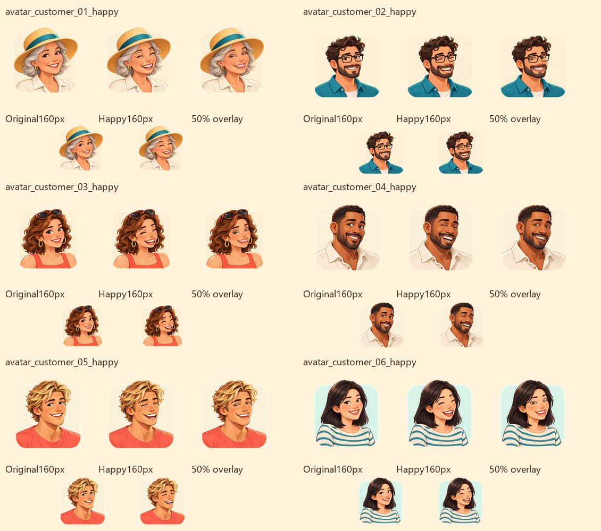
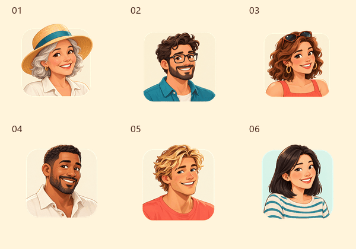
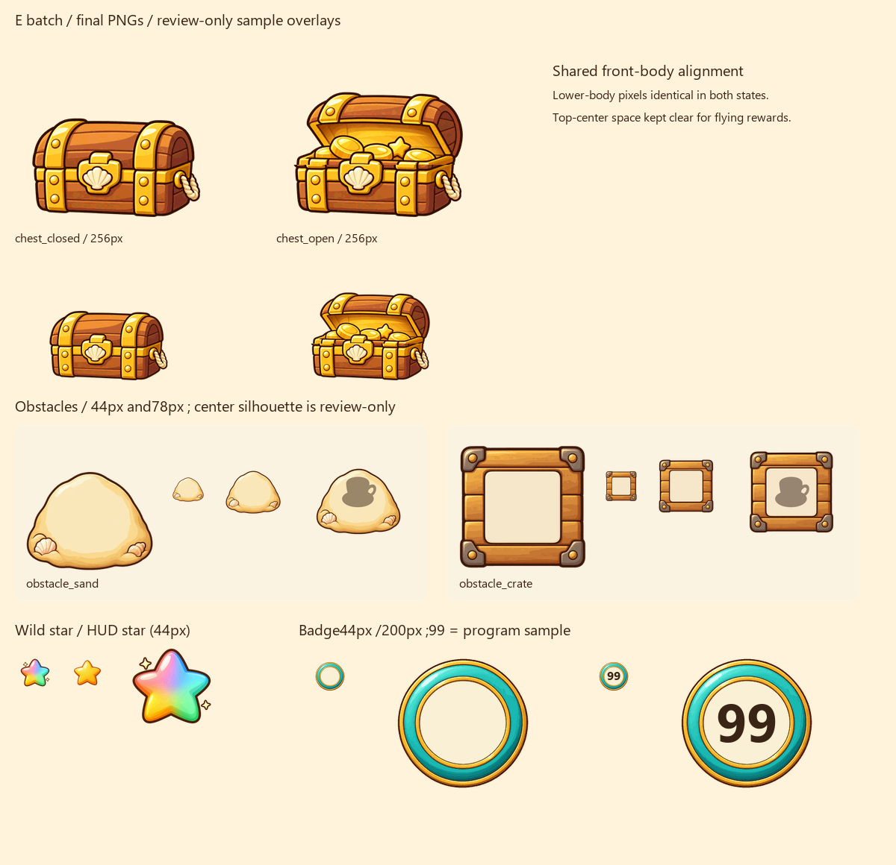
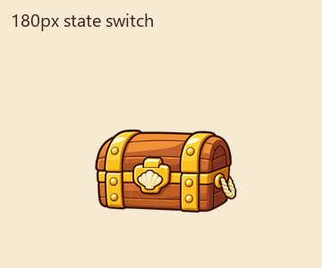
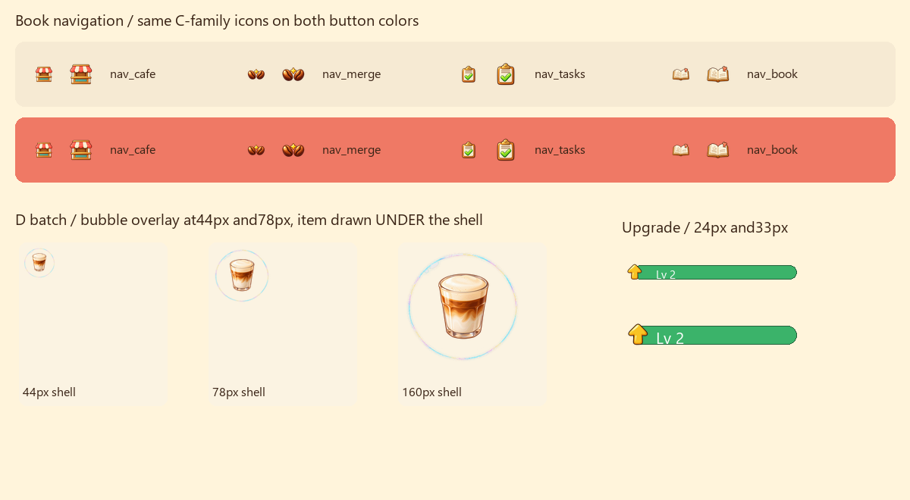

# Merge Café Lite · E 批交付（附 D 批）

按 main `d7aaded`（#59 已合并）的 `ASSETS.md §9–10` 和 Issue #58 制作。分支：`codex/merge-cafe-batch-e-art`。**E 批 13 张、D 批 2 张全部交齐，无待画项。只新增图片与交付材料，未改代码、`art.json`、原头像或旧素材；不提 PR、不代发 Issue 评论。**

E 批 **365446 字节（0.365 MB）**，D 批 **22348 字节（0.022 MB）**，均在各自总额和每张上限内。合计新增 **387794 字节**。当前全部运行 PNG/WebP 图片合计 **3495495 字节（3.495 MB）**，低于 4 MB；不含评审图，亦不代表完整构建包体。

## 给 Claude 的接入说明

- 6 个开心头像放在 `assets/avatars/`，分别与同编号原头像直接切换；其余 UI 图放 `assets/ui/`，百搭星放 `assets/items/`。登记与 V1 接入由开发侧完成，本批未改登记配置。
- 所有图片按交付的完整画布绘制。**不要再次裁透明边或把宝箱两态分别居中**，否则会破坏配对对齐。
- 头像在原图固定的眼口表情区域装配 image_gen 编辑结果，发型、肩线、服饰、底板等沿用原图。最终 alpha 和原头像逐像素一致；原图文件未覆盖。PNG 导出有颜色量化，非表情区最终 RGB 会有轻微量化差异（平均约 2.2–3.1/255），构图没有移动。
- 宝箱两态共用下半部箱体区域 `[0,176,256,256]`，最终 PNG 该区域像素完全一致；打开态上方 `x68–188,y0–70` 完全透明，留给奖励飞出。箱盖、箱口与内部金币/暖光是两态差异。
- 沙堆和木箱四周至少留 8px。中部直径约 120px 保持浅色干净；木箱另有覆盖 120×120 的空白标签。剪影由程序叠加，资源里未画物品。
- 徽章中心保持奶油色留白，程序写等级；评审图中的 `99`、剪影和 `Lv 2` 都是对照叠字，没有烘焙进素材。
- D 批泡泡中心直径 170px 区域 **alpha 最大值为 0**，食物图应画在泡泡下面；底部保留薄边，高光集中于左上。升级箭头按现有绿色等级胶囊接入。
- 本目录的评审 PNG/GIF、提示词与 manifest 不进运行包。预览均由最终图片离线合成，**不是游戏已接入截图**。

## 文件与体积

以下路径相对 `games/merge-cafe-lite/assets/`。全部为 sRGB、32 位 RGBA PNG。除 `nav_book`、`icon_upgrade` 为 96×96 外，均为 256×256。

| 批 | 文件 | 字节 | 上限 |
| --- | --- | ---: | ---: |
| E | `avatars/avatar_customer_01_happy.png` | 38577 | 40000 |
| E | `avatars/avatar_customer_02_happy.png` | 35573 | 40000 |
| E | `avatars/avatar_customer_03_happy.png` | 37260 | 40000 |
| E | `avatars/avatar_customer_04_happy.png` | 35863 | 40000 |
| E | `avatars/avatar_customer_05_happy.png` | 35934 | 40000 |
| E | `avatars/avatar_customer_06_happy.png` | 37123 | 40000 |
| E | `ui/chest_closed.png` | 19106 | 30000 |
| E | `ui/chest_open.png` | 28099 | 30000 |
| E | `ui/obstacle_sand.png` | 18618 | 25000 |
| E | `ui/obstacle_crate.png` | 22053 | 25000 |
| E | `items/item_wild_star.png` | 25507 | 30000 |
| E | `ui/badge_level.png` | 24469 | 25000 |
| E | `ui/nav_book.png` | 7264 | 15000 |
| D | `ui/fx_bubble.png` | 17913 | 20000 |
| D | `ui/icon_upgrade.png` | 4435 | 8000 |

## 已做的检查

- 头像以 110px、160px 和半透明叠图检查；附原图/开心态切换 GIF。
- 宝箱以 180px、原始 256px 和两态切换检查，核对共用箱体像素及底边。
- 障碍以 44px、78px 对比，并叠 50% 物品剪影；百搭星和顶栏金星以 44px 并排比较。
- 徽章以 44px、200px 检查空白圆心及两位数空间；Book 与 C 批底栏在奶油/珊瑚两种底色上以 26px、34px 比较。
- 泡泡以 44px、78px 叠食物图检查；升级箭头以 24px、33px 在绿底检查。
- 核对 15 张尺寸、透明度、PNG RGBA8 文件头、每张/每批预算、SHA-256，及 6 张原头像未改变。详细记录在 `manifest.json`。

美术由内置 image_gen 创作；最终提示词见 `generation-prompts.md`。固定区域装配后做尺寸转换与颜色量化以控制体积，未用代码绘制造型。宝箱采用同一通道量化规则，保持共用箱体像素一致；其他 PNG 的量化参数记录在 manifest 中。

## 预览

