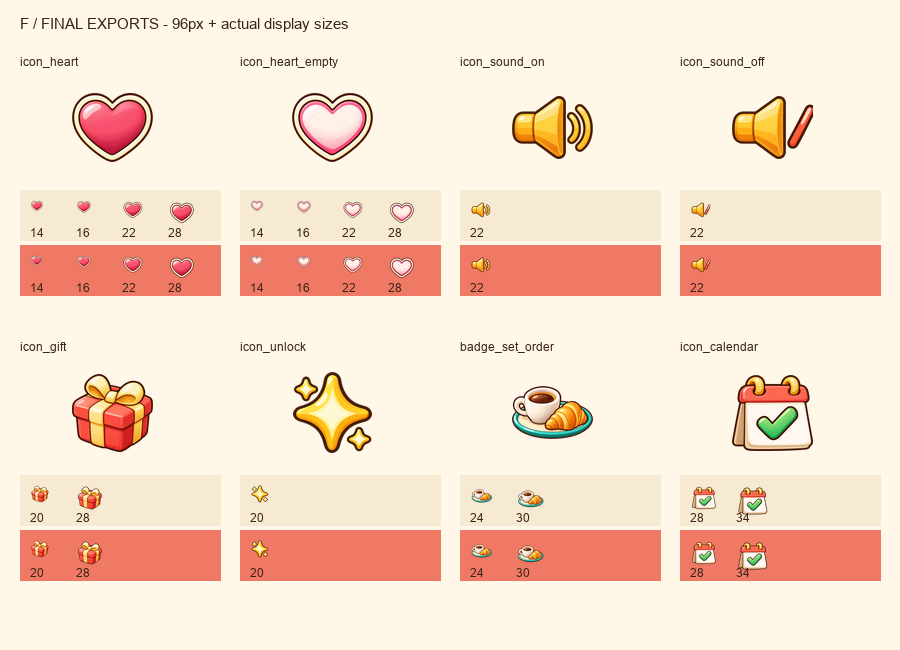
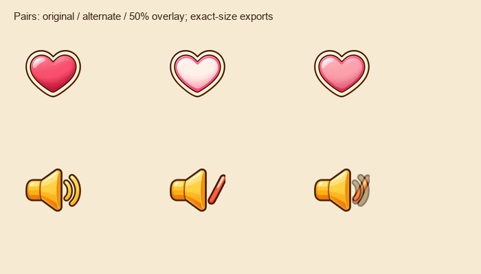
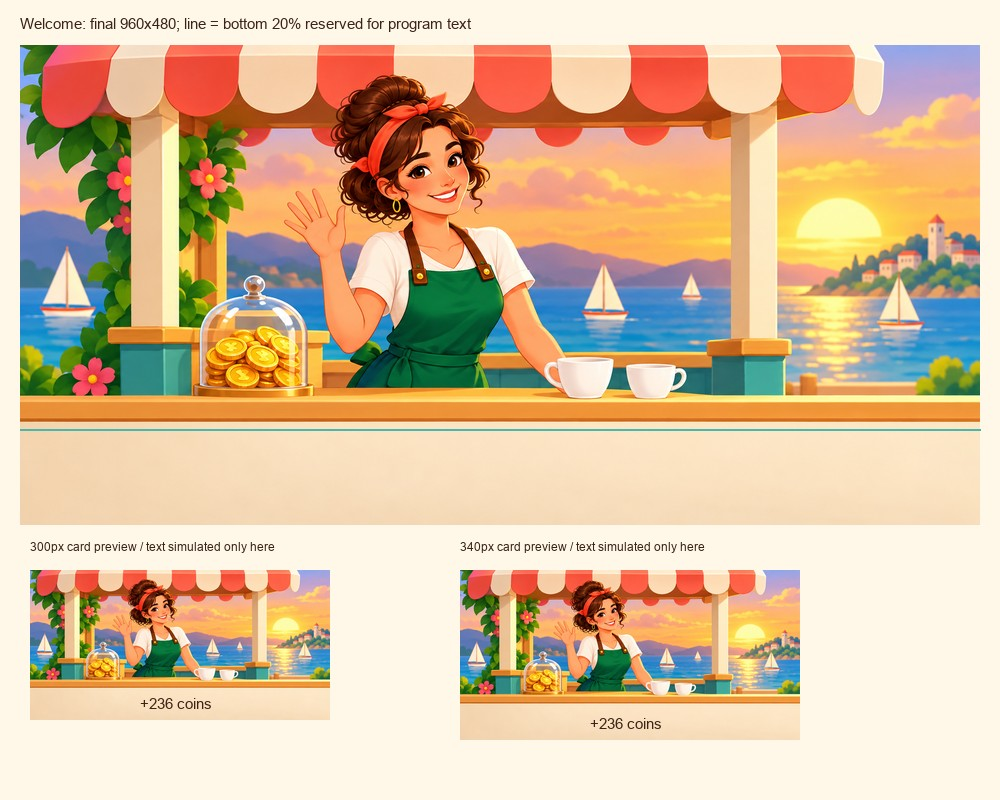

# F 批美术交付（Issue #63）

分支 `codex/merge-cafe-batch-f-art`；基于 main `b703ca5`。只新增 9 张图片和本目录说明/检查图，未修改代码、art.json 或已有图片。

8 张图标均为 96×96 RGBA 透明 PNG，插画为 960×480 WebP（quality=80）。金币罐、人物和杯子位于插画底部保留区上方；下方 20% 留浅色。图中无文案。

| 文件（均在 assets/ui/） | 字节 |
|---|---:|
| `icon_heart.png` | 7,451 |
| `icon_heart_empty.png` | 7,577 |
| `icon_sound_on.png` | 5,160 |
| `icon_sound_off.png` | 4,362 |
| `icon_gift.png` | 8,286 |
| `icon_unlock.png` | 7,506 |
| `badge_set_order.png` | 7,180 |
| `icon_calendar.png` | 6,827 |
| `welcome_back.webp` | 41,292 |

运行素材合计 **95,641 字节**（95.6 KB），低于 170,000 字节；每张图标 ≤12,000 字节，插画 ≤60,000 字节。检查图和 GIF 仅供审阅，不打进运行包。

合入本批后，当前 assets/ 下运行图片合计 **3,591,136 字节**（约 3.591 MB），仍低于 4 MB。基线 main 已包含 #62 的 E/D 批接入。

## 检查与接入

- 心在 14/16/22/28 px、喇叭 22 px、其余图标按任务单实际尺寸检查，并附奶油/珊瑚背景对照。
- 心两状态共用完全相同的 alpha 和外沿像素；喇叭左侧 62 列 RGBA 完全相同，仅右侧声波切换为斜杠。导出采用共用坐标和色阶，避免自动居中造成跳动。
- 插画按 300/340 px 卡片宽检查，模拟数字只存在检查图中。
- 所有创意图像由内置 image_gen 生成/编辑，随后仅进行尺寸、共同区域对齐和 PNG/WebP 编码导出。最终提示词、SHA256、预算与位置检查见 manifest.json。
- 本批未做游戏接入；Claude 合入图片后负责登记 art.json 和构建。未创建 PR 或回复 Issue。
- V2 熟客故事漫画未开工，不包含在本批中。

## 审阅图

[心切换](heart-states.gif) · [静音切换](sound-states.gif)
