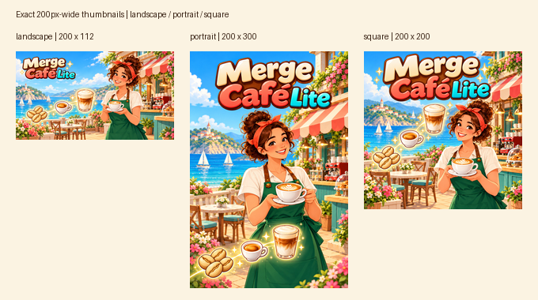
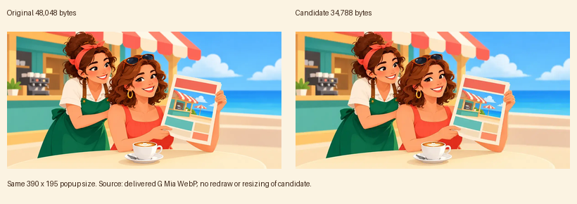

# H 批：CrazyGames 上架封面（issue #67）

已交付 3/3，分支 `codex/merge-cafe-batch-h-store`。只新增图片与说明；不改代码、art.json、运行资源，也不提 PR。

## 投稿文件

位置：`../../store/crazygames/`。依照 issue #67 允许的高质量 JPG 格式导出，**质量 95，4:4:4，无色度抽样，嵌入 sRGB ICC**。

| 文件 | 尺寸 | 字节 |
|---|---|---:|
| [cover_landscape.jpg](../../store/crazygames/cover_landscape.jpg) | 1920×1080 | 899,377 |
| [cover_portrait.jpg](../../store/crazygames/cover_portrait.jpg) | 800×1200 | 562,496 |
| [cover_square.jpg](../../store/crazygames/cover_square.jpg) | 800×800 | 442,850 |

三张分别生成并排版，再缩放到精确尺寸；竖版、方形并非横版裁切。横版字标位于左上，约占宽度 34%；竖版上部居中；方形上部居中。均以咖啡师、装修完成的海边咖啡馆、咖啡豆→浓缩→玻璃拿铁及合成闪光为主。选用单人物构图，以便缩小时识别。咖啡师端着拉花拿铁，服装、盘发与红发带沿用 comic_01。

画面唯一文字为 **Merge Café Lite**（保留 é）；无边框、商店或社交平台标志、按钮、额外促销词。游戏物品参考 item_coffee_01 / 03 / 05 的形状和颜色，作为合成玩法元素呈现。图中没有额外招牌文字。

### 200 px 宽检查

检查图中三张分别为 200×112、200×300、200×200，均直接由最终 JPG 缩小；人物脸、标题、合成物品仍可辨识。已经复核实际文件尺寸、RGB 模式、sRGB ICC 和重新解码；SHA-256 见 cover-validation.txt。画面由内置 imagegen 生成，后处理仅精确缩放、编码与检查图拼版。提示词见 generation-prompts.md。

规格依据：[issue #67](https://github.com/qq245562635/game-guess/issues/67)、M6 分支 ASSETS.md §12（`merge-cafe-lite/v1-m6` @ `328869f`），以及 [CrazyGames 官方封面规范](https://docs.crazygames.com/requirements/game-covers/)（2026-10-22 查阅）。CrazyGames 官方要求三种尺寸、仅游戏名称文字、无边框与平台图标；以上已逐项检查。最终审核仍由平台执行。

## G 批漫画 ≤35 KB 试验

实验使用 G 批已交付 [comic_reg_mia.webp](https://github.com/qq245562635/game-guess/blob/638f9ffbd8fedb7c72bf68d151d97810d3bdaefd/games/merge-cafe-lite/assets/comics/comic_reg_mia.webp)，原始文件 SHA-256 为 `8182b918addbcbf45222b0cf581a807ec97af8bc3119df55ea2dee1d6edad194`。

| 版本 | 尺寸 | WebP 质量 | 字节 |
|---|---|---:|---:|
| 已交付原图 | 1200×600 | 78 | 48,048 |
| [35 KB 候选](comic_reg_mia_35kb.webp) | 1200×600 | 61 | **34,788** |

节省 **13,260 bytes（27.6%）**。直接从已交付 WebP 重新编码，method=6；逐整数降低质量，首个 ≤35,000 bytes 的值为 61。未重绘、未缩小候选尺寸、未模糊或减色。候选和比较图只放 art/，不替换游戏内原图。

[全尺寸对比图](mia-35kb-comparison.png) 包含左右原图/候选完整画面，以及人物和店报的 1:1 像素局部。**视觉判断：手机弹窗尺寸可接受**，表情、人物轮廓、店报与拿铁仍清楚；1200×600 原尺寸下，头发、肤色渐变和店报细线有轻微变软与压缩痕迹。这个结论仅覆盖背景较简洁的 Mia，不能保证所有新场景都在同样质量下达到 35 KB。新稿宜从无损源直接编码，逐张验收。

### 对后续 12 张的包体影响

按现有美术 **3,880,713 bytes**、红线 **4,000,000 bytes** 估算，剩余 **119,287 bytes**。

- 12 张 × 35,000 = **420,000 bytes**，新增后为 **4,300,713 bytes**，仍超出 **300,713 bytes**。
- 即使把现有 G 批全部降到每张 35,000（这只是预算假设，未实测或替换其他 5 张），最多相对现有 288,900 节省 78,900 bytes；再加 12 张后仍为 **4,221,813 bytes**，超出 **221,813 bytes**。
- 因此 35 KB 的画质可以作为下一步目标，但不足以解决 12 张的包体；需要先另行释放约 0.30 MB，或确定漫画按需加载/外置方案。实际所需余量还应包含后续资源空间。

本批封面在 store/、检查和压缩试验在 art/，**新增运行美术字节为 0**。后续 ♥1 / ♥3 漫画和 V2 区域未开画。预览视频由程序侧使用实机录制，本批不包含视频。
