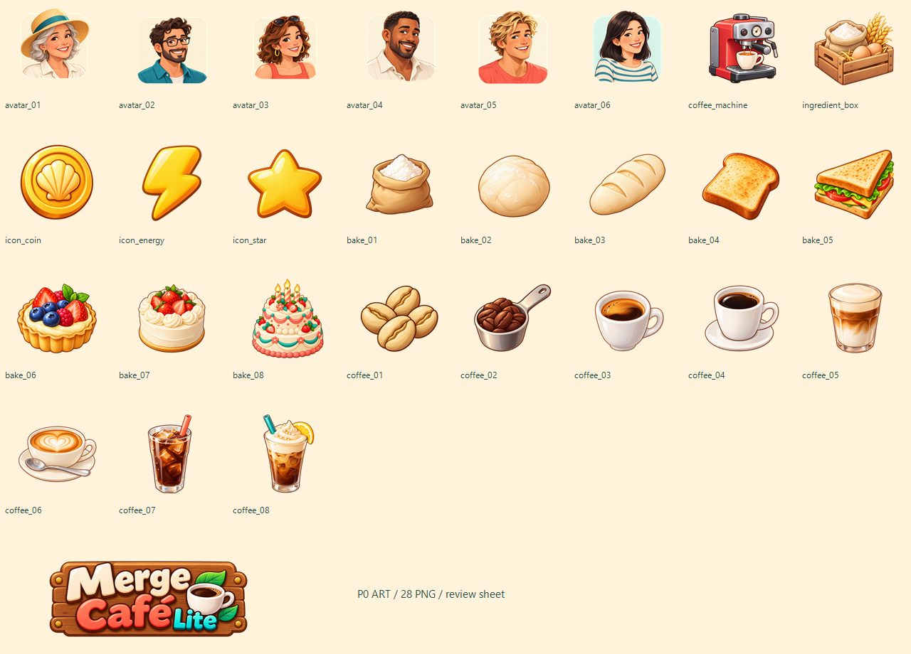
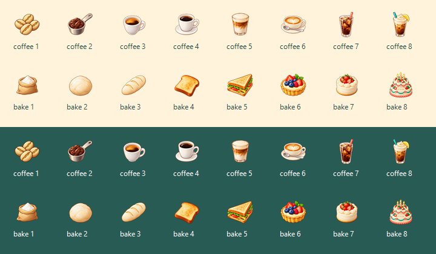

# Merge Café Lite — P0 美术资源

Issue #38 第二阶段，按用户要求仅制作美术，不修改代码或登记配置。规格依据 [M3 ASSETS.md](https://github.com/qq245562635/game-guess/blob/merge-cafe-lite/m3-deco/games/merge-cafe-lite/ASSETS.md)（读取版本 blob `51c96c9a516b110d85835861d7b74e9c5d402353`）；画风依据第一阶段主界面效果图和五个欧美参考。

## 交付范围

P0 共 28 个 PNG：16 个物品、2 个生成器、6 个顾客头像、3 个货币图标、1 个 Logo。场景、装修图层、漫画和小图标是下一批，不包含在本批中。

| 文件夹 | 文件名 | 规格 |
| --- | --- | --- |
| `assets/items/` | `item_coffee_01`–`item_coffee_08` | 256×256，透明 PNG-32 |
| `assets/items/` | `item_bake_01`–`item_bake_08` | 256×256，透明 PNG-32 |
| `assets/items/` | `gen_coffee_machine`、`gen_ingredient_box` | 256×256，透明 PNG-32 |
| `assets/avatars/` | `avatar_customer_01`–`avatar_customer_06` | 256×256，自带圆角浅色底板，外角透明 |
| `assets/ui/` | `icon_energy`、`icon_coin`、`icon_star` | 128×128，透明 PNG-32 |
| `assets/ui/` | `logo_merge_cafe_lite` | 1024×384，透明 PNG-32 |

图片使用内置 image_gen 逐张生成；效果图仅作为画风参考，未复用参考游戏素材。导出只裁掉透明空边、等比缩放、居中留边，保留原始 alpha。除 Logo 外不包含文字；图标不画落地阴影；物体本身保留左上光源和体积明暗。生成器冷却灰态由程序处理。

## 给开发侧的登记清单

以下是接入用的清单说明；本批不修改 `src/config/art.json`，也不运行构建或声称正式图已在游戏中验证。

- `items`：`item_coffee_01`、`item_coffee_02`、`item_coffee_03`、`item_coffee_04`、`item_coffee_05`、`item_coffee_06`、`item_coffee_07`、`item_coffee_08`、`item_bake_01`、`item_bake_02`、`item_bake_03`、`item_bake_04`、`item_bake_05`、`item_bake_06`、`item_bake_07`、`item_bake_08`、`gen_coffee_machine`、`gen_ingredient_box`。
- `avatars`：`avatar_customer_01`、`avatar_customer_02`、`avatar_customer_03`、`avatar_customer_04`、`avatar_customer_05`、`avatar_customer_06`。
- UI 货币及 Logo：按 ASSETS.md，图到后由开发侧接入。

## 人物对应

01 银发草帽年长女士；02 深卷发、胡须、眼镜男士；03 棕卷发、头顶墨镜、大耳环女士；04 深肤色短发亚麻衬衫男士；05 金发冲浪青年；06 东亚面孔、齐肩黑发、条纹海魂衫女士。均为成年人物自然五官，不画 Q 版或日系大眼。

## 字体与 Logo

Logo 品牌名固定为 **Merge Café Lite**，字标为生成式栅格美术，不是随附字体的精确排版。游戏 UI 字体继续使用第一阶段交付的 Nunito，授权见 `art/issue-38-main-screen/fonts/OFL.txt`。Logo 是唯一允许包含文字的图片。

## 交付自检

- 28/28 文件尺寸正确，均为 PNG-32（RGBA，sRGB）；有透明和不透明像素，所有图片最外一圈均完全透明。
- 16 个物品已按实际 48×48 像素置于奶油色和深青色背景人工并排核对，8 级轮廓与结构可区分。评审图中的文字仅为检查标签，不在资源图片里。
- 六位顾客自带底色与圆角，不依赖程序裁切；年龄、肤色、发型和服装有差异。
- Logo 拼写已核对，最终版去掉悬挂绳，保留木牌、咖啡杯与叶子。
- 28 个运行用 PNG 合计 **2,358,329 字节（2.36 MB，2.25 MiB）**，低于 4 MB 总预算。本批体积高于需求文档各类的估算额度；后续 P1/P2 在 4,000,000 字节预算下仅余 **1,641,671 字节**，应控制场景图层裁切与 WebP 压缩，不能按各节估算继续累加。
- `manifest.json` 记录逐图尺寸、字节、alpha 统计、内容边界和 SHA-256；`generation-prompts.md` 记录逐图提示词。
- 总览图、48px 检查图、清单和提示词是评审材料，不应打入游戏资源包。第一阶段整屏效果图同样不属于运行用资源。
- 本 PR 只添加图片和美术交付说明，未修改代码、`art.json`、构建产物或玩法配置。正式图的游戏内渲染验收由开发侧登记后进行；本次不标记“已接入”。
